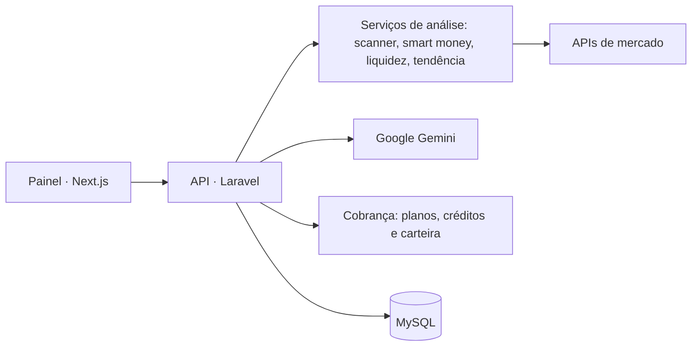

# CriptoAI — Inteligência de mercado cripto com IA

> Plataforma de análise de criptoativos: scanner de oportunidades, smart money, mapa de liquidez, tendência e novas listagens, em um painel com planos e créditos.

> **Repositório vitrine.** O código-fonte é proprietário (FML Tech) e fica privado. Aqui estão o problema, a arquitetura e as decisões técnicas. Demonstração técnica disponível sob solicitação.

## O problema

Quem investe em cripto precisa juntar dados de várias fontes para entender para onde o dinheiro está indo. A CriptoAI reúne esses sinais em um painel único e usa IA para interpretar o mercado. Também é oferecida em white-label, para criadores de conteúdo do nicho terem a ferramenta com a própria marca.

## O que o sistema faz

- **Scanner de oportunidades** e **scanner gráfico**
- **Smart money**: acompanhamento de fluxo de grandes carteiras
- **Mapa de liquidez** e **análise de tendência**
- **Novas listagens**, ICOs e airdrops
- **Dados on-chain**
- **Análises com IA** (Google Gemini)
- **Planos, assinaturas e pacotes de créditos**, com carteira interna e histórico de transações
- **Academy**: conteúdo educacional dentro da plataforma

## Arquitetura

- Frontend e API em repositórios separados, cada um com Docker para produção.
- Cada análise é um **serviço isolado** no backend, o que permite ligar e desligar módulos por plano.
- A cobrança por **créditos** controla o consumo das análises mais caras.

## Stack

| Camada | Tecnologias |
|---|---|
| Backend | PHP 8.2, Laravel, Sanctum, carteira digital (bavix/laravel-wallet) |
| IA | Google Gemini |
| Frontend | Next.js, React, TypeScript, Tailwind, Radix UI |
| Infra | Docker, Docker Compose, GitHub Actions |

## Status

Produto da FML Tech, oferecido também em white-label.

## Autor

**Felipe Lopes** · Full-stack e fundador da [FML Tech](https://fmlsoftware.com.br)
Produto, backend e integrações de dados e IA.
